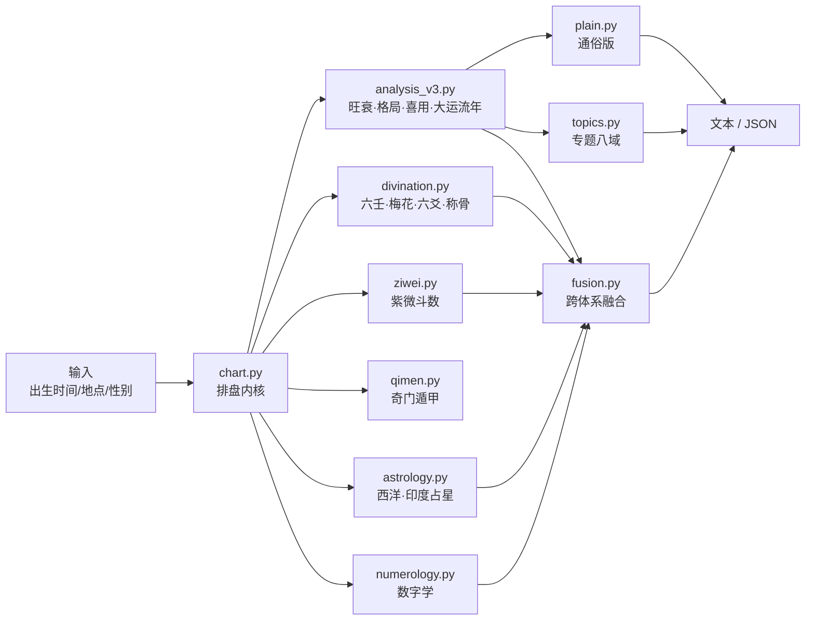

<div align="center">

# 八字命理分析与跨体系推测引擎 · bazi-skill

**纯标准库 · 零依赖 · 17 套 5253 项回归测试 · 可作为 DSH skill 或 CLI 使用**

[](https://github.com/zhaoshen39-star/Bazi-skill/actions/workflows/tests.yml)
[](https://www.python.org/)
[](#)
[](#测试)
[](LICENSE)

</div>

> 排盘用可验证的历法/天文算法；分析与推测遵循古典命理规则体系，并**明确区分「可验证」与「不可验证」**。
> 所有打分都是内部刻度，不是概率。

---

## 目录

- [它是什么 / 不是什么](#它是什么--不是什么)
- [优势：为什么不是又一个算命 App](#优势为什么不是又一个算命-app)
- [快速开始](#快速开始)
- [示例输出](#示例输出)
- [能力矩阵](#能力矩阵)
- [架构](#架构)
- [测试](#测试)
- [已知边界](#已知边界)
- [许可](#许可)

## 它是什么 / 不是什么

**是**：一个把「排盘 → 结构分析 → 传统术数 → 跨体系融合 → 人话输出」串成一条链的引擎，规则、权重、口径全部写进 `references/`，可复现、可审计。

**不是**：不是"预测 App"，不是概率模型，也不能告诉你哪年结婚、哪年发财。

| 层 | 可验证性 |
|---|---|
| 排盘（节气、干支、真太阳时、大运方向） | ✅ 可交叉验证（228 项历法校验 + 独立公式校验） |
| 占星星历（VSOP87/Meeus/ELP、Placidus 宫位） | ✅ 对 ephem 星历：太阳 0.005°、月亮 0.002° |
| 紫微安星 | ✅ 对 iztro 378 盘、2.8 万字段 0 不一致 |
| 旺衰 / 格局 / 喜用 / 打分 | ❌ 不可验证；只能保证「同一口径下可复现」 |
| 六爻 / 奇门 / 称骨 / 数字学 | ❌ 文化传统，只描述结构 |

## 优势：为什么不是又一个算命 App

| 维度 | 市面上常见 | 本项目 |
|---|---|---|
| **排盘精度** | 只到"时辰"级，不校正真太阳时 | 真太阳时 / 节气边界 / 晚子时双流派 / 时区与夏令时；228 项历法交叉验证 |
| **透明度** | 黑箱打分 + 话术 | 旺衰权重、取格优先级、调候 120 格、成败阈值**全部写进 `references/`**，可复现、可改、可审计 |
| **覆盖范围** | 单一体系（只排八字，或只排紫微） | 八字 + 紫微 + 奇门 + 六爻 + 小六壬 + 梅花 + 称骨 + 西洋/印度占星 + 数字学 + **跨体系融合**，一条命令 |
| **输出方式** | 术语堆砌，或纯鸡汤 | 同一份报告两种读法：`--brief` 人话（≤400 字）/ 技术版；`--topic` 只看某几域 |
| **可验证性** | 无法核对 | 星历对 ephem（太阳 0.005°、月亮 0.002°）、紫微对 iztro（378 盘 2.8 万字段 0 不一致）、**5253 项回归测试** |
| **古典校准** | 无 | 64 例《子平真诠》原文命例逐例复算，一致率 64.9% → **89.2%**，反哺修正 7 处引擎逻辑，差异逐条归档 |
| **边界诚实** | 暗示"很准" | 明确分层：排盘/星历可验证，旺衰/格局/喜用**不可验证**；不给假命中率 |
| **多体系用法** | 结果互相矛盾时靠人脑硬凑 | 融合层输出**共识/分歧/张力**标签（分歧处往往比一致处有信息量），且声明"不互相验证" |
| **依赖** | 需 numpy / requests / 联网 / 联网 API | **纯标准库、零第三方依赖、离线可跑**（Python 3.12+） |
| **接入** | 只能看网页/App | CLI、`--json` 结构化输出、DSH skill 三种接入；带 CI 与回归测试 |

**一句话**：把"排盘 → 结构分析 → 传统术数 → 跨体系融合 → 人话输出"做成一条**可审计的流水线**，而不是一个输出玄学结论的黑盒。

## 快速开始

要求：Python 3.12+（无第三方依赖）。

```bash
git clone git@github.com:zhaoshen39-star/Bazi-skill.git
cd Bazi-skill
```

```bash
# 1) 完整技术盘（真太阳时 + 大运流年）
python scripts/bazi.py --date 1990-06-15 --time 08:00 --sex male \
  --longitude 116.41 --latitude 39.90 --true-solar-time --focus-year 2026

# 2) 人话摘要（≤400 字）
python scripts/bazi.py --date 1990-06-15 --time 08:00 --sex male --brief

# 3) 只看婚恋与事业
python scripts/bazi.py --date 1990-06-15 --time 08:00 --sex male --topic love,career

# 4) 全量：多术数层 + 紫微 + 奇门 + 融合 + 占星 + 数字学
python scripts/bazi.py --date 1990-06-15 --time 08:00 --sex male \
  --divination --ziwei --qimen --fusion --astro --numerology --focus-year 2026

# 5) JSON（给程序用）
python scripts/bazi.py --date 1990-06-15 --time 08:00 --sex male --json
```

Windows 控制台（GBK）下脚本会自动把标准输出切到 UTF-8，不会乱码。

## 示例输出

<details>
<summary><code>--brief</code> 人话摘要（点击展开）</summary>

```text
【一句话】金底子薄，需要外力帮，压力出成绩型；近两三年以守为主，别冒进。
【性格】像金属：讲规则、重结果，对自己要求高
【长处】你最需要、也最能帮上忙的力量是「水」：沟通、变化、流动性的机会（信息、贸易、物流、互联网一类）。
【注意】事情一多就觉得累，一个人扛不动太多，别硬撑。
【现在】2017–2026 年这十年（乙酉）：整体偏吃力，主题偏「机会财和异性缘、同辈和自立」。
【钱与工作】你的路子是：适合压力大但能出成绩的岗位。
【2026年】整体吃力；怎么用：以守为主：把账理清、把人脉和身体顾好，大动作留到下半年。；避开：忌冲动投资、替人担保、硬换赛道。
【说明】倾向与建议，不是确定预测；不预测具体事件。
```

</details>

<details>
<summary><code>--json</code> 输出结构（点击展开）</summary>

```jsonc
{
  "input":   { "year": 1990, "month": 6, "day": 15, "hour": 8, "sex": "male" },
  "time":    { "utc": "...", "cst": "...", "used": "...", "used_kind": "standard" },
  "chart":   { "pillars": [ /* 年/月/日/时，各含 gan/zhi/藏干/十神/纳音/地势 */ ],
               "dayun":   { "forward": true, "list": [ /* 9 步，含 timing */ ] },
               "liunian": [ /* 聚焦年 ±6，含 timing/应期 */ ] },
  "analysis":{
    "strength":  { "label": "偏弱", "ratio": 0.19, "confidence": "高",
                   "party_shares": { "比劫": 2.4, "印星": 18.5, "财星": 39.9, "官杀": 27.7, "食伤": 11.5 } },
    "pattern":   { "name": "正财格", "status": "成格", "good": [], "bad": [], "candidates": [] },
    "yong_shen": { "shen_roles": { "水": "用神", "金": "喜神", "木": "忌神" },
                   "arbitration": { "rule": "调候急需优先" },
                   "methods": { "fuyi": {}, "tiaohou": {}, "tongguan": [], "bingyao": [] } }
  },
  "method":  { "version": 3 /* 全部权重、口径、免责 */ }
}
```

</details>

## 能力矩阵

| 模块 | 能力 | 实现 |
|---|---|---|
| 排盘 | 真太阳时、节气边界、晚子时双流派、大运/流年/流月、神煞、干支关系 | `scripts/chart.py` |
| 结构力旺衰 | 柱位权重 × 藏干分层 × 十神亲和 × 刑冲合害折损；置信度、五党结构力、从格识别 | `scripts/analysis_v3.py` |
| 格局 | 子平真诠取格（本气/中气/余气透干、四生四旺取本气、杂气透干优先）、顺逆用、相神、成败 `severity/resolved`、救应、月令损伤 | `scripts/analysis_v3.py` |
| 喜用 | 扶抑 / 调候（《穷通宝鉴》120 格）/ 通关 / 病药 四法合参 + 仲裁；用神力量判定 | `scripts/analysis_v3.py` |
| 大运流年 | 基调（五行）+ 引动（伏吟/反吟/冲合刑害/岁运并临/半合），综合分与应期 | `scripts/analysis_v3.py` |
| 通俗版 | `--brief` / `--plain`，术语翻译、等级化表达、三条建议 | `scripts/plain.py` |
| 专题八域 | 婚恋 / 事业 / 财富 / 学业 / 健康 / 六亲 / 迁移 / 人际 | `scripts/topics.py` |
| 多术数层 | 小六壬、梅花易数、六爻纳甲（含断语层）、袁天罡称骨、西洋星座、生肖纳音 | `scripts/divination.py` |
| 紫微斗数 | 三合派安星、亮度表、三方四正、13 格局三态、大限主题、四化 | `scripts/ziwei.py` |
| 奇门遁甲 | 时家转盘拆补法：定局、九宫、三奇六仪、九星八门八神、值符值使、旬空马星 | `scripts/qimen.py` |
| 西洋/印度占星 | 截断 VSOP87 + Meeus 太阳 + ELP 月亮、Placidus 宫位、相位 orb、Lahiri 近似 + 27 宿 | `scripts/astrology.py` |
| 数字学 | 生命灵数、生日数、成熟数、个人年、Lo Shu 网格（可选姓名笔画） | `scripts/numerology.py` |
| 跨体系融合 | 六体系九域投票、共识/分歧标签、张力分析、时机合成 | `scripts/fusion.py` |

## 架构



```
SKILL.md                 技能入口（DSH skill 格式）
scripts/bazi.py          命令行入口（参数解析、组装报告、渲染）
scripts/chart.py         排盘内核（节气/干支/大运，内置 lunar_python）
scripts/analysis.py      旧版（v2）分析函数，保留供兼容测试
scripts/analysis_v3.py   结构力旺衰 + 子平格局 + 四法喜用 + 大运流年引动
scripts/plain.py         通俗版输出层
scripts/topics.py        专题推测八域
scripts/divination.py    小六壬 / 梅花 / 六爻（断语层）/ 称骨 / 星座 / 生肖
scripts/ziwei.py         紫微斗数（安星 + 断语层）
scripts/qimen.py         奇门遁甲（时家转盘拆补法）
scripts/astrology.py     西洋 / 印度占星
scripts/numerology.py    数字学
scripts/fusion.py        跨体系融合层
scripts/tiaohou_table.py 《穷通宝鉴》120 格调候表
scripts/chenggu_table.py 袁天罡称骨表
scripts/vendor/          内置 lunar_python（MIT，见 NOTICE.md）
references/              规则、方法学、数据源、输出契约（13 份）
tests/                   17 套回归测试 + fixture
```

## 测试

```bash
python tests/run_all.py     # 17 套、5253 项
```

| 套件 | 项数 | 内容 |
|---|---:|---|
| verify | 42 | v1 基础回归 |
| verify_v2 | 49 | v2 兼容契约 |
| verify_v3 | 94 | v3 分析层 |
| verify_plain | 52 | 通俗版 |
| verify_topics | 302 | 专题八域 |
| verify_relations | 13 | 干支关系 |
| verify_regressions | 22 | 历史回归 |
| verify_optimizations | 12 | 优化项 |
| verify_independent | 24 | 独立公式校验 |
| verify_calendar | 228 | 历法交叉验证 |
| verify_divination | 168 | 多术数层 |
| verify_ziwei | 502 | 紫微（含 iztro 对照） |
| verify_qimen | 2543 | 奇门排盘 |
| verify_astrology | 468 | 占星对 ephem 星历 |
| verify_numerology | 203 | 数字学 |
| verify_fusion | 337 | 跨体系融合 |
| verify_cases | 194 | 古典命例对照（测量口径，非门禁） |

## 已知边界

- 不同流派对同一命盘可能给出相反结论；本项目**选一种口径并把分歧写进文档**（`references/`），不假装唯一正确。
- 命理是文化传统，不是科学预测。输出只是「按某套规则推演出的结构描述」，**不构成任何决策依据**。
- 六爻、奇门、称骨、数字学只做结构描述，不作吉凶断言。
- 紫微按三合派安星；庚/壬干化科、阴干月劫等流派差异在 `references/` 里注明。

## 许可

本项目代码采用 [MIT](LICENSE) 许可。内置的 `lunar_python`（6tail，MIT）见 [`scripts/vendor/NOTICE.md`](scripts/vendor/NOTICE.md)。
